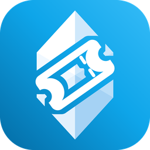
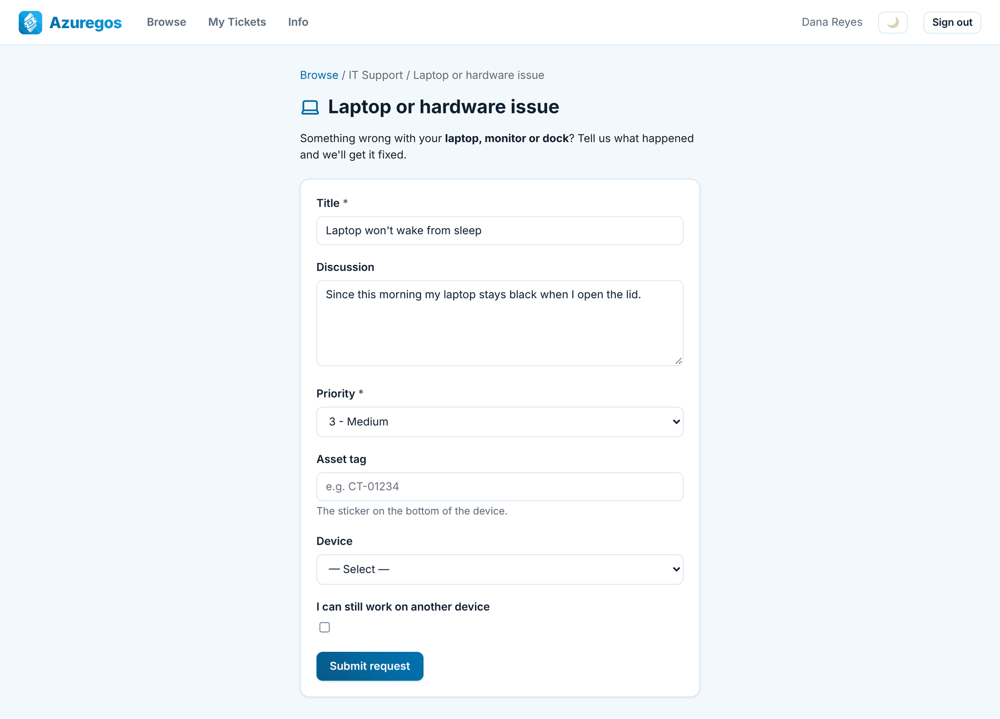
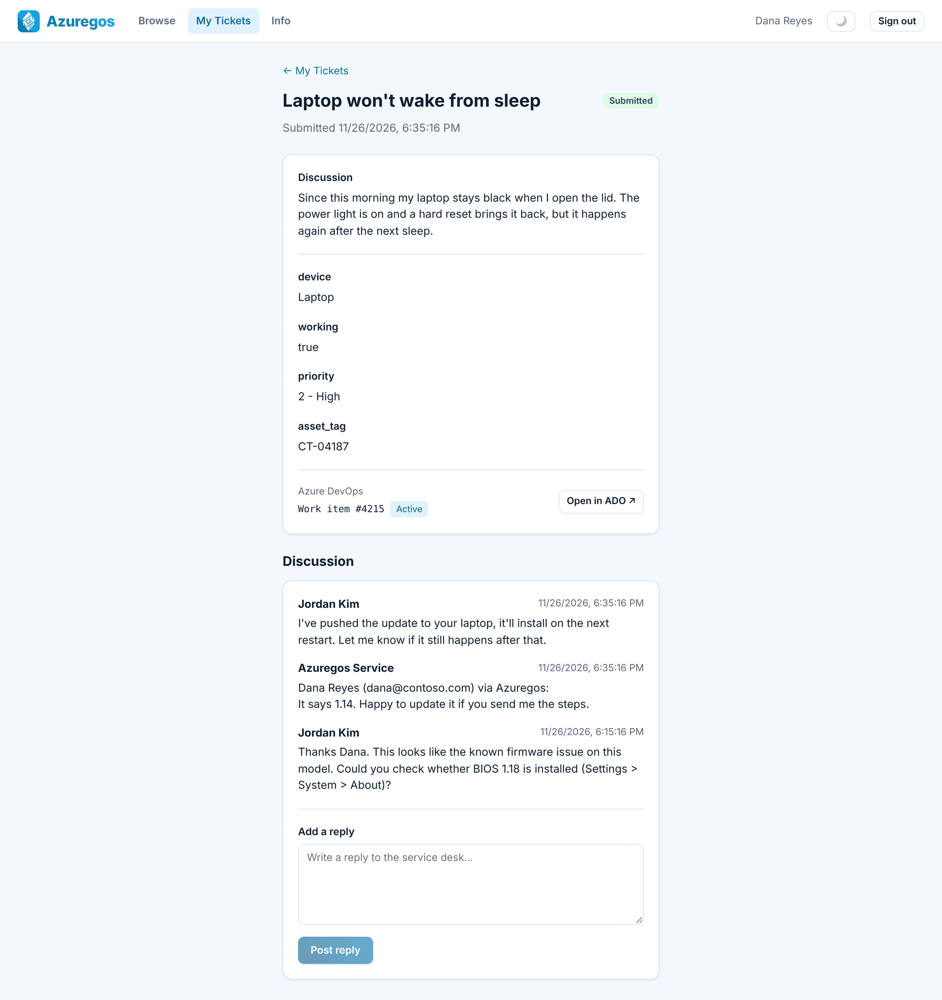
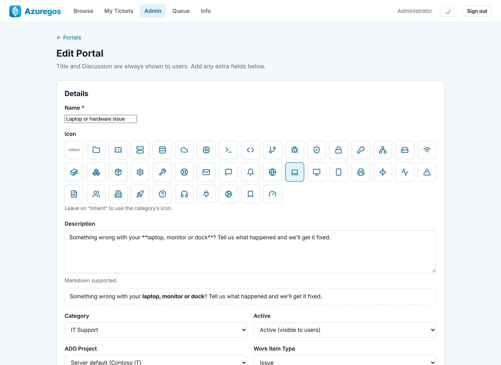
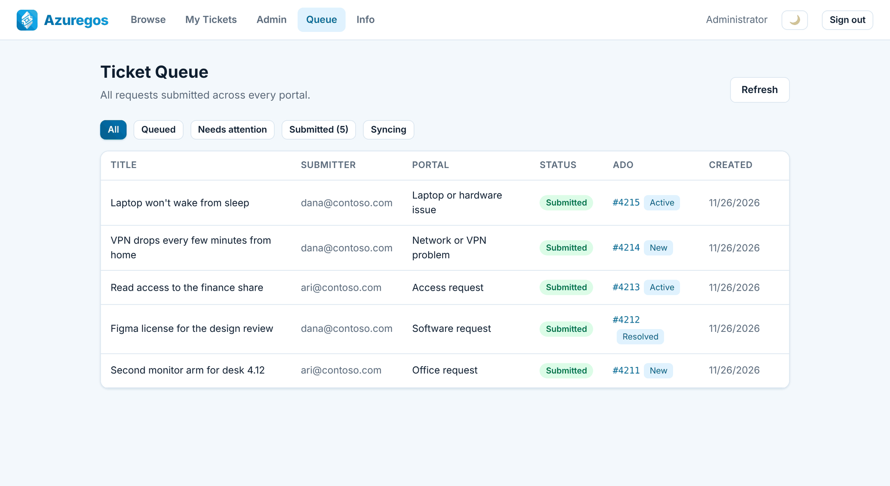

<p align="center">
  
</p>

<h1 align="center">Azuregos</h1>

<p align="center">
  <strong>A friendly service desk in front of Azure DevOps.</strong><br>
  Self-hosted, open source, and yours.
</p>

<p align="center">
  <a href="https://github.com/zollo/azuregos/actions/workflows/ci.yml"></a>
  <a href="https://github.com/zollo/azuregos/releases"></a>
</p>

---

Azuregos lets people who don't have Azure DevOps (ADO) access ask your team for
help. They pick a **portal** from a catalog, fill in a short form, and follow
their ticket through to done. Every ticket becomes a real ADO work item, so your
team keeps working in Azure DevOps while everyone else gets a simple front door.
You run it yourself, so the requests and your ADO token stay on your server.

<p align="center">
  
</p>

## Features

**Portals your admins design**
- Each portal is a form in front of one ADO work-item type and area path. Title
  and description are always there; add text, long text, number, select,
  multi-select, date, checkbox and email fields as needed.
- Map a field onto a real ADO field (like `Microsoft.VSTS.Common.Priority`), or
  leave it unmapped and its answer is added to the work-item description.
- The work-item type and area path are checked against your live ADO project
  when you save, and a submitter can never override the portal's area path.

**A catalog people can find their way around**
- Portals are grouped into categories, each with an icon. Portals without a
  category show up under **General**.
- Descriptions are written in Markdown.

**Tickets that never get lost**
- A submission is saved in Azuregos first and then sent to ADO. If ADO is down
  or not configured yet, the ticket waits as *Queued* and a background worker
  retries it every `ADO_RETRY_INTERVAL_SECONDS`, up to `ADO_MAX_RETRY_ATTEMPTS`
  times. Admins can retry a ticket from the queue at any time, for example
  once a long outage is over.
- **My tickets** shows each requester their own tickets and their status.
- A discussion thread on every ticket: replies are posted to the work item's
  ADO comments with the requester's name, and your team's ADO comments show up
  in Azuregos.

<p align="center">
  
</p>

**Fits into Azure DevOps**
- No custom fields or process changes needed. Azuregos marks its work items
  with tags: `azuregos`, `azuregos-portal:<slug>` and
  `azuregos-submitter:<email>`.
- Connect ADO with environment variables, or from **Admin → Azure DevOps** in
  the app (see [Azure DevOps](#azure-devops) below).

**Role-based admin access**
- **Super admins** can do everything, including the ADO connection and granting
  super admin.
- **Admins** manage portals, categories, users and the whole ticket queue.
- **Portal admins** edit only the portals they're assigned to, and see and
  retry those portals' tickets.
- **End users** browse the catalog, submit tickets and follow their own.

<p align="center">
  
</p>

<p align="center">
  
</p>

**Sign in your way**
- Local accounts, OpenID Connect (OIDC) and SAML 2.0. Federated users are
  created as end users on their first sign-in, and an admin can promote them.

**Safe by default**
- The ADO token saved in the app is encrypted and never shown again.
- Description Markdown is rendered with raw HTML disabled, and ADO comment HTML
  is turned into plain text before it reaches the browser.
- Release images are signed with cosign and ship with a build-provenance
  attestation.

## Self-hosting

Azuregos is a FastAPI backend, a Celery worker (the same image) that pushes
tickets to ADO, a React app served by nginx, Postgres and Redis. Images are
published to GHCR as `ghcr.io/zollo/azuregos-backend` and
`ghcr.io/zollo/azuregos-frontend` for every release.

### Docker Compose

```bash
git clone https://github.com/zollo/azuregos.git && cd azuregos
cp .env.example .env        # then edit .env (see the table below)
docker compose -f docker-compose.yml up -d --build
```

Open http://localhost:8080 and sign in with the bootstrap admin from `.env`
(`admin@azuregos.local` / `admin` unless you changed it, so change it).

Pass `-f docker-compose.yml` for a real deployment: plain `docker compose up`
(and `make up`) also loads `docker-compose.override.yml`, a development setup
with hot reload.

Settings to review in `.env`:

| Setting | What it does |
|---|---|
| `SECRET_KEY` | Signs sign-in tokens and encrypts the ADO token saved in the app. Use a long random string (`openssl rand -hex 32`). Changing it means re-entering that token. |
| `POSTGRES_PASSWORD` | Database password. Set it before the first start; changing it later doesn't change the existing database's password. |
| `CORS_ORIGINS` | The address people use. The first entry is where OIDC and SAML sign-ins return to. |
| `BOOTSTRAP_ADMIN_EMAIL`, `BOOTSTRAP_ADMIN_PASSWORD` | The first super admin, created on startup if it doesn't exist. |
| `ADO_ORG_URL`, `ADO_PAT`, `ADO_DEFAULT_PROJECT` | Your Azure DevOps organization, token and project. Optional if you connect ADO in the app. |
| `ADO_RETRY_INTERVAL_SECONDS`, `ADO_MAX_RETRY_ATTEMPTS` | How often queued tickets are retried, and when to give up. |
| `OIDC_*`, `SAML_*` | Turn on federated sign-in. |

Every option is documented in [`.env.example`](.env.example). The frontend
proxies `/api` to the backend, so only one port needs to be published; put
your own HTTPS reverse proxy in front of it.

### TrueNAS SCALE

[`deploy/truenas/`](deploy/truenas/) has a compose file that uses the prebuilt
images and keeps Postgres on a dataset you can snapshot. See its
[README](deploy/truenas/README.md).

### Kubernetes (Helm)

The chart needs `SECRET_KEY` and `POSTGRES_PASSWORD`, either from a Secret you
create or from `secrets` in your values. `BOOTSTRAP_ADMIN_PASSWORD` and
`ADO_PAT` can go in the same Secret:

```bash
kubectl create secret generic azuregos-secrets \
  --from-literal=SECRET_KEY="$(openssl rand -hex 32)" \
  --from-literal=POSTGRES_PASSWORD="$(openssl rand -hex 16)" \
  --from-literal=BOOTSTRAP_ADMIN_PASSWORD="$(openssl rand -hex 12)"

helm install azuregos oci://ghcr.io/zollo/charts/azuregos --version <release> \
  --set existingSecret=azuregos-secrets \
  --set ingress.enabled=true --set ingress.hosts[0]=azuregos.example.com \
  --set config.CORS_ORIGINS=https://azuregos.example.com
```

The chart runs database migrations on start and keeps the worker at one
replica, since it also schedules the retries. Its Ingress sends `/api`,
`/docs`, `/redoc` and `/openapi.json` to the backend. It can also run Postgres
and Redis for you, or point at your own, and `postgresql.backup` adds a nightly
`pg_dump` CronJob (restore with `pg_restore --clean --if-exists`). See
[`charts/azuregos/values.yaml`](charts/azuregos/values.yaml) for every option.

Our own dev and prod instances are deployed by Argo CD; their configuration
lives in [zollo/homelab-k8s](https://github.com/zollo/homelab-k8s) under
`gitops/apps/azuregos/`.

### Azure DevOps

Create a personal access token with **Work Items: Read & Write**, then either
set the `ADO_*` variables or sign in as a super admin and open
**Admin → Azure DevOps**. There you enter the organization URL, the token and a
default project, click **Test connection**, then **Save**.

- A connection saved in the app wins over the environment variables and
  replaces them as a whole. **Remove saved connection** goes back to them.
- Changes apply right away to the app and the worker, with no restart.
- Switching to a different organization is refused while any ticket is linked
  to a work item, because tickets only store the work-item ID.

### Verifying images

```bash
IMAGE=ghcr.io/zollo/azuregos-backend:latest

cosign verify "$IMAGE" \
  --certificate-identity-regexp "https://github.com/zollo/azuregos/.github/workflows/ci.yml@.*" \
  --certificate-oidc-issuer https://token.actions.githubusercontent.com

gh attestation verify "oci://$IMAGE" --repo zollo/azuregos
```

## API

Everything the web app does goes through a REST API under `/api`. Interactive
docs are served at `/docs`, and the OpenAPI spec at `/openapi.json` (a copy of
the current one is committed at [docs/openapi.json](docs/openapi.json)).

### MCP server

[`mcp-server/`](mcp-server/) is an MCP server that exposes the same API to AI
assistants (Claude Code, Claude Desktop and other MCP clients), one tool per
endpoint, generated from the spec so it never falls behind:

```bash
claude mcp add azuregos -e AZUREGOS_URL=https://azuregos.example.com \
  -e AZUREGOS_EMAIL=assistant@example.com -e AZUREGOS_PASSWORD=... \
  -- uvx --from "git+https://github.com/zollo/azuregos#subdirectory=mcp-server" azuregos-mcp
```

See [mcp-server/README.md](mcp-server/README.md) for setup and the tool list.

## Development

```bash
make up                     # full stack with hot reload: app on :8080, API on :8000
(cd backend && pip install ".[dev]" && ruff check . && pytest -q -m "not functional")
(cd frontend && npm install && npm run build && npm test)
```

The tests in `backend/tests/functional/` run against a real Azure DevOps
organization. They run whenever `ADO_ORG_URL` and `ADO_PAT` are set, either
exported in your shell or in `backend/.env.test` (copy
`backend/.env.test.example`), and are skipped otherwise. Use a short-lived
token (Work Items: Read & Write); every work item they create is deleted
afterwards. Run them with
`make functional-test`.

See [CLAUDE.md](CLAUDE.md) for commands and architecture notes, and
[CONTRIBUTING.md](CONTRIBUTING.md) for branching and PR-title rules (squash
merges, Conventional Commits drive the release version).

**Stack:** FastAPI · SQLAlchemy 2 (async) · Alembic · Celery · Postgres · Redis ·
React + Vite + TypeScript · nginx · Docker Compose · Helm
